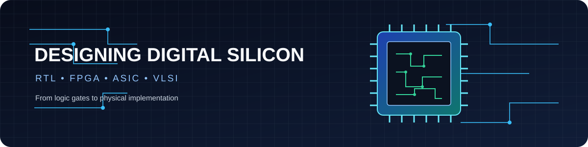
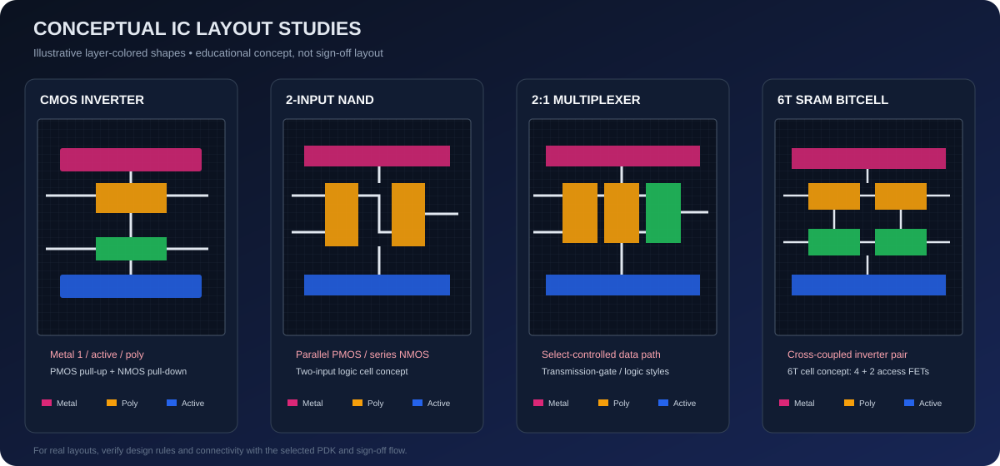

<div align="center">



# Ayushmaan Sharma

### Electronics & Communication Engineering | VLSI • RTL Design • FPGA • ASIC Physical Design

*Building digital systems from RTL to silicon — one block at a time.*

<p>
  <a href="https://github.com/USERNAME"></a>
  
  
</p>

</div>

---

## `01` · About Me

I'm an ECE student interested in **digital VLSI design, computer architecture, FPGA prototyping, and ASIC implementation**. I enjoy connecting RTL-level logic to real hardware and exploring how a design moves through synthesis, floorplanning, placement, clock-tree synthesis, routing, and physical verification.

- **Digital design:** Verilog HDL, RTL simulation, custom IP integration
- **SoC & architecture:** RISC-V, memory-mapped peripherals, GPIO and timer IP
- **ASIC physical design:** OpenLane, OpenROAD, Sky130, Yosys, Magic, Netgen, OpenSTA
- **Hardware platforms:** FPGA boards, microcontrollers, embedded systems
- **Currently exploring:** reusable RTL blocks, timing-aware design, and RTL-to-GDSII workflows

> Physical-design work is presented here as project/workshop learning, separate from my VLSI internship experience.

## `02` · IC Layout Lab

A small visual index of the kinds of standard-cell and block-level layouts I’m interested in studying and documenting. These are **illustrative conceptual layouts**, not foundry-qualified or tapeout-ready layouts.

<p align="center">
  
</p>

| Layout study | Design focus | What to document |
|---|---|---|
| **CMOS Inverter** | PMOS/NMOS pull-up and pull-down network | Schematic, transient response, sizing and layout |
| **2-input NAND** | Series NMOS, parallel PMOS | Truth table, stick diagram, DRC/LVS |
| **2:1 MUX** | Select-controlled data path | Logic implementation, transistor count, delay |
| **6T SRAM bitcell** | Cross-coupled inverters + access transistors | Read/write concept, stability and cell layout |

## `03` · Featured Work

### Digital VLSI SoC Design & Planning
Learning and documenting an open-source RTL-to-GDSII flow using **Sky130, OpenLane/OpenROAD, Yosys, Magic, Netgen and OpenSTA**. Topics include floorplanning, placement, CTS, routing, STA, DRC/LVS and GDSII generation.

### RISC-V SoC & Custom Peripheral IP
Worked with a RISC-V SoC workflow and developed/integrated **GPIO and timer IP** through memory-mapped interfaces, with RTL simulation and FPGA validation.

### FPGA & RTL Experiments
Verilog-based digital logic experiments, peripheral integration, simulation, and board-level bring-up using open-source FPGA tools.

> Replace the project titles above with direct links to your actual repositories once you confirm the repository URLs.

## `04` · Contribution Activity

<div align="center">

<!-- Contribution heatmap from GitHub -->


<table>
<tr>
<td>

</td>
<td>

</td>
</tr>
</table>

</div>

### Contribution Snake (optional)

To show an animated snake eating your contribution graph, add the workflow below to your profile repository at `.github/workflows/snake.yml`. It publishes an SVG to the `output` branch.

```yaml
name: Generate contribution snake

on:
  schedule:
    - cron: "0 0 * * *"
  workflow_dispatch:
  push:
    branches:
      - main

permissions:
  contents: write

jobs:
  generate:
    runs-on: ubuntu-latest
    steps:
      - uses: Platane/snk@v3
        with:
          github_user_name: USERNAME
          outputs: |
            dist/github-contribution-grid-snake.svg
            dist/github-contribution-grid-snake-dark.svg?palette=github-dark
      - uses: crazy-max/ghaction-github-pages@v4
        with:
          target_branch: output
          build_dir: dist
        env:
          GITHUB_TOKEN: ${{ secrets.GITHUB_TOKEN }}
```

After the workflow runs, add this image where you want the animation to appear:

```markdown

```

## `05` · Tools & Technologies

<p align="center">
  
  
  
  
  
  
  
  
  
  
  
</p>

## `06` · What I’m Building Toward

- Reusable, well-tested RTL blocks and small SoC subsystems
- Better understanding of timing, area, power, and physical-design trade-offs
- Documented standard-cell layouts with schematic, simulation, and verification evidence
- Practical open-source ASIC workflows from RTL through GDSII

---

<div align="center">

**Thanks for visiting — explore the repositories to see what I’m learning and building.**

<sub>Template structure inspired by <a href="https://github.com/creativetimofficial/github-profile-template">Creative Tim’s GitHub Profile Template</a>. Visual assets in this bundle are original conceptual illustrations.</sub>

</div>
