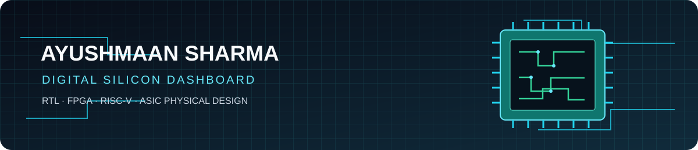
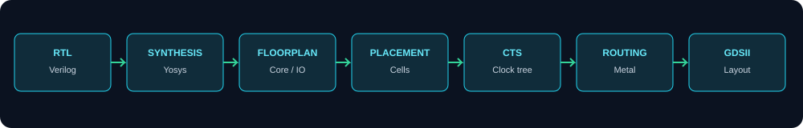
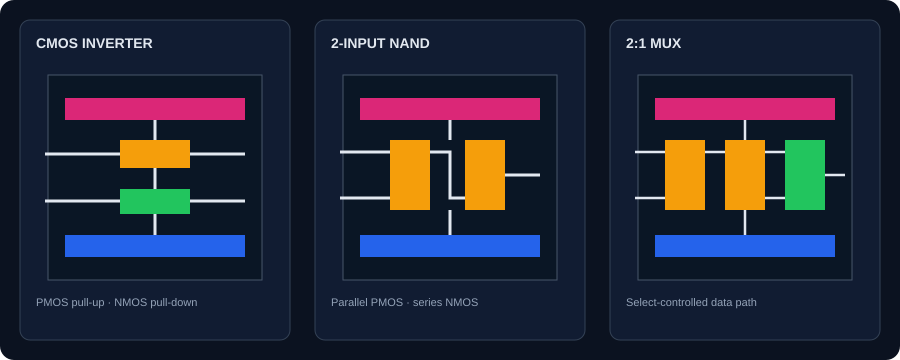
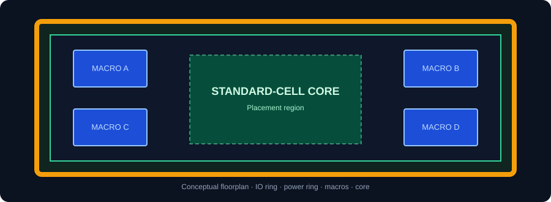
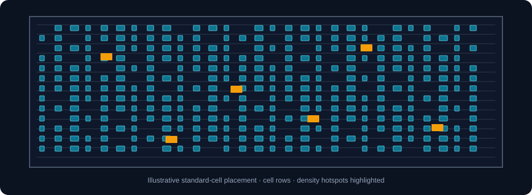
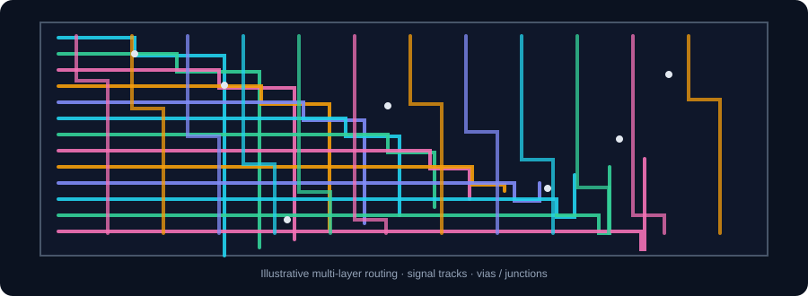

# Ayushmaan Sharma
### ECE Student · Digital VLSI · RTL · FPGA · ASIC Physical Design

**From logic design to silicon implementation.**

---

<table>
<tr>
<td width="30%" valign="top">

## 👤 Profile

<!-- Add your own portrait at assets/profile.jpg, then uncomment the image below. -->
<!--  -->

**Ayushmaan Sharma**  
Electronics & Communication Engineering

📍 India  
🔬 Digital design & semiconductor systems

**Focus areas**
- RTL design
- RISC-V / SoC
- FPGA prototyping
- ASIC physical design

**Navigation**
- [About](#-about)
- [IC layout lab](#-ic-layout--physical-design-lab)
- [Featured projects](#-featured-projects)
- [Contribution activity](#-contribution-dashboard)
- [Toolbox](#-toolbox)

</td>
<td width="70%" valign="top">

## 👋 Howdy!

I'm an ECE student fascinated by how digital logic becomes physical silicon. I like working across the hardware stack—from Verilog and memory-mapped peripherals to FPGA bring-up and open-source RTL-to-GDSII flows.

My current interests include **reusable RTL blocks, RISC-V SoCs, CMOS logic, standard-cell layout, timing analysis, and physical-design trade-offs**.

</td>
</tr>
</table>

## 🧩 IC Layout & Physical Design Lab

*Conceptual educational illustrations. These are not foundry-qualified layouts or sign-off results.*

<table>
<tr>
<td width="50%" valign="top">

### 01 · CMOS Standard Cells

**Study:** CMOS inverter · NAND2 · 2:1 MUX  
**Explore:** transistor topology, active regions, polysilicon, metal routing, DRC/LVS.

</td>
<td width="50%" valign="top">

### 02 · Floorplan & Macro Planning

**Study:** core area, utilization, IO planning, macro placement and power distribution.

</td>
</tr>
<tr>
<td width="50%" valign="top">

### 03 · Placement

**Study:** standard-cell rows, legalization, congestion, density and timing-aware placement.

</td>
<td width="50%" valign="top">

### 04 · Routing

**Study:** routing layers, vias, signal paths, congestion and design-rule constraints.

</td>
</tr>
</table>

## 🚀 Featured Projects

<table>
<tr>
<td width="50%" valign="top">

### `01` RISC-V SoC & Peripheral IP
**RTL · Memory-mapped IO · FPGA**

- GPIO and timer peripheral concepts
- Register maps and firmware integration
- RTL simulation and board-level debugging

[Explore my repositories →](https://github.com/USERNAME?tab=repositories)

</td>
<td width="50%" valign="top">

### `02` RTL-to-GDSII Learning Flow
**Yosys · OpenLane/OpenROAD · Sky130**

- Synthesis and timing constraints
- Floorplan, placement, CTS and routing
- STA, DRC/LVS and GDSII flow exploration

[Explore my repositories →](https://github.com/USERNAME?tab=repositories)

</td>
</tr>
<tr>
<td width="50%" valign="top">

### `03` Verilog & CMOS Experiments
**Digital logic · Simulation · Circuit design**

- Combinational logic and mux designs
- CMOS inverter, NAND and NOR studies
- Waveform-driven verification

</td>
<td width="50%" valign="top">

### `04` FPGA & Embedded Systems
**Hardware/software integration**

- FPGA prototyping and custom IP
- Embedded C and peripheral communication
- Hardware bring-up and debugging

</td>
</tr>
</table>

> Replace the generic repository links above with direct links to the relevant public repositories. Only label a project as completed after uploading its code and evidence.

## 📈 Contribution Dashboard

<table>
<tr>
<td width="50%">

</td>
<td width="50%">

</td>
</tr>
</table>

### 🐍 Optional contribution animation

A workflow is included at `.github/workflows/snake.yml`. After you replace `USERNAME`, commit the file, and enable GitHub Actions, it can publish an animated contribution snake to the `output` branch.

## 🛠 Toolbox

---

**Building carefully. Verifying thoroughly. Learning silicon one layer at a time.**

Layout graphics are original conceptual illustrations. Replace them with verified tool screenshots as your projects mature.

